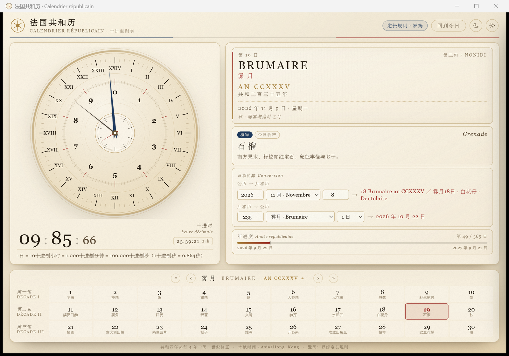
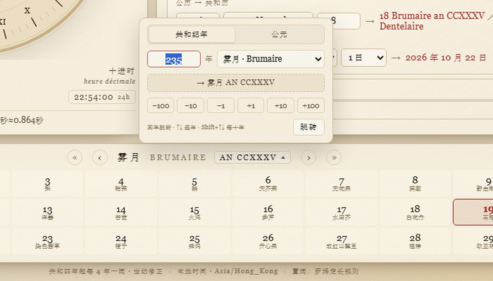
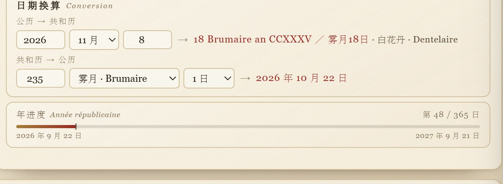
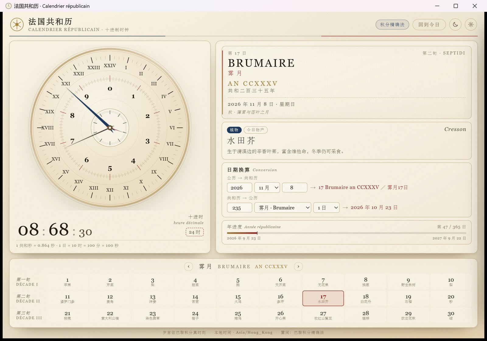

# 法国共和历 · Calendrier républicain

Windows 桌面上的法国共和历日历时钟。单文件 exe，绿色免安装。

> A desktop clock for the French Republican calendar on Windows: decimal time (10 hours a day), a dual-track dial, 30-day months, the day-of-year produce list, and both leap-year rules to compare. Single-file exe, UI in vanilla HTML/CSS/JS.



## 直接使用

双击 `dist\法国共和历.exe` 即可。

- 首次启动需要系统里装有 **Microsoft Edge WebView2 运行时**（Windows 10/11 一般自带）。
  若缺失，程序会给出提示和下载链接：<https://go.microsoft.com/fwlink/p/?LinkId=2124703>
- 设置、窗口位置保存在 `%LOCALAPPDATA%\RepublicanCalendar\`，删除该目录即可恢复默认。
- 窗口大小、位置会被记住；最小尺寸 880×560（设计尺寸 1180×800）。

## 功能

**十进制时钟**
1 日 = 10 共和时 = 1000 共和分 = 100000 共和秒，1 共和秒 ≈ 0.864 秒。
数字钟以 `时 : 分 : 秒` 显示，旁边小字显示同一时刻的 24 小时制与本地时间。点一下这个小字块可以把 24 时制收起（变成虚线框的「24 时」），再点一下展开——按钮不会消失。

**双轨表盘**
- 外圈：24 小时刻度 + 罗马数字 I–XXIV，每 15° 一大格，每格 4 小格。
- 内圈：0–9 十进小时阿拉伯数字，一圈 1000 小格（每大格 100 小格），每 100 格一条红色分界。
- 指针：蓝针走一天一圈，几何上同时读外圈 24 时与内圈十进时；细墨针读十进分（一圈 100 分）；中央小秒盘走十进秒（一圈 100 秒）。
- 全部指针每一帧都由**绝对时间戳**重算，不做周期累加，所以长时间运行不会漂移。

**历日**
- 日期牌：日号、周名（Primidi…Décadi）、法文月名、中文月名、罗马数字年号、中文年号、公历对照、季节与月候。
- 每日物产卡：法文名 + 中文名 + 类别 + 农事介绍，按 1793 年 10 月 5 日法令的物产表。
- 月历：三旬 × 十日，标出今日与选中日；闰日（补充日）单独一栏。
- 年月快速切换：`‹ ›` 翻月，`« »` 翻年；点年号（AN CCXXXV）弹出跳转面板，两种输入方式：
  - 共和纪年：输入年号（可填负数表示共和纪年前，如 -3 显示为「前四年」）+ 选月；也可只调年份保留当前月。
  - 公元：输入公历年 + 选月（月名附法文），按「该月多数日子落在哪一共和月」换算，例如 2026-11 → 雾月 AN CCXXXV、1789-07 → 获月 前四年。
  - 面板下方 ±1 / ±10 / ±100 按当前模式增减年份，预览行实时显示落点；键盘 `← →` 翻月、`↑ ↓` 翻年、`Shift+↑ ↓` 跳十年、`Y` 打开年份面板、`Esc` 关闭。

**日期换算**
公历 → 共和历、共和历 → 公历双向即时换算。
两个方向都按当前置闰规则（定长规则法 / 巴黎秋分精确法）计算，在设置里切换规则后结果会立即重算。
公历 → 共和历的结果在日期后直接跟上当日物产，如「18 Brumaire an CCXXXV ／ 雾月18日 · 白花丹 · Dentelaire」；日期无效时只显示「日期无效」。

**设置**（右上齿轮）
- 置闰规则：定长规则法（罗姆）/ 巴黎秋分精确法，可切换。
- 时钟基准：本地时间 / 巴黎平太阳时。
- 外观：随系统 / 羊皮纸 / 墨夜。
- 制式：十进时 + 24 时，或仅十进时。

## 界面截图

**年份跳转面板**（可按共和纪年或公元年月跳转）



**日期换算**（结果直接跟上当日物产）



**24 时制收起态**（虚线框的「24 时」，再点一下展开）



## 两种置闰规则

| | 定长规则法（默认） | 巴黎秋分精确法 |
|---|---|---|
| 岁首 | 由 1792-09-22 起按 365/366 推算 | 巴黎子午线（UTC+9m21s）上秋分真实时刻所在日 |
| 闰年 | 年号 4 的倍数；整百年为平年，四百年仍闰，第 40 世纪（4000 年）为例外 | 由秋分时刻决定 |
| 2026-11-08 | **18 Brumaire an CCXXXV** | 17 Brumaire an CCXXXV |

两法在共和元年至十四年一致（这十四年按史实秋分定年），此后按所选规则推算，故在 an XV 处无缝衔接。
参考页面（中文维基「法国共和历」条目里的当日小组件）采用定长规则法，本程序默认与之相同。

## 校验点

| 共和历 | 公历 |
|---|---|
| 1 Vendémiaire an I | 1792-09-22 |
| 9 Thermidor an II | 1794-07-27 |
| 18 Fructidor an V | 1797-09-04 |
| 18 Brumaire an VIII | 1799-11-09 |
| 1 Vendémiaire an XIV | 1805-09-23 |
| 1 Vendémiaire an XV | 1806-09-23 |

以上在两种规则下均成立。`node tools/test_calendar2.js` 会跑一遍史实校验、两法对照与逐日往返换算（-40000…120000 天，失败 0）。

## 技术实现

- 界面：HTML + CSS + 原生 JavaScript（无框架、无构建步骤）。表盘为内联 SVG，全部刻度由 JS 生成。
- 外壳：.NET Framework 4.8 WinForms + WebView2（Chromium 内核）。
- 打包：用系统自带的 `csc.exe` 编译（不需要装 SDK），网页资源、WebView2 托管程序集与 `WebView2Loader.dll` 全部以资源形式嵌进单文件 exe；运行时释放到 `%LOCALAPPDATA%\RepublicanCalendar\app\`，以虚拟主机名 `https://calendar.local/` 提供（真实 origin，localStorage 可用）。
- 源码：

```
src/www/      index.html  styles.css  app.js  calendar.js  data.js
src/app/      Program.cs  MainForm.cs  app.manifest
tools/        build_data.py（生成 data.js）  make_icon.py（生成 app.ico）
assets/       app.ico（构建输入：窗口图标与 exe 图标）
build.ps1     编译脚本
vendor/       WebView2 1.0.4314.35 的 DLL
.github/      workflows/release.yml（打 tag 自动编译并上传 Release 附件）
```

`build/`（中间产物）与 `dist/`（成品）都由 `build.ps1` 生成，已列入 `.gitignore`，不入库；成品请从 [Releases](https://github.com/ClukayN/french-republican-calendar-clock/releases) 下载。

## 重新构建

```powershell
powershell -ExecutionPolicy Bypass -File .\build.ps1          # 产物 dist\法国共和历.exe
powershell -ExecutionPolicy Bypass -File .\build.ps1 -Run     # 编译并启动
```

需要：Windows + .NET Framework 4.8（系统自带）+ WebView2 运行时。

### 自动发布

推送形如 `v1.0.1` 的 tag 会触发 GitHub Actions：在 windows-latest 上编译，创建（或更新）同名 Release 并上传 `french-republican-calendar-clock-<tag>.exe`。手写过的 Release 说明不会被覆盖，只更新附件。

## 数据与文献

- 月名、日名、闰日名依 1793 年 10 月 5 日法令；法文名以法文维基百科 *Calendrier républicain* 校订。
- 中文名与农事说明取自中文维基百科「法国共和历」条目。
- 纪元与闰法争议见法文维基百科 *Calendrier républicain* § Romme 与 Note 64。

## 已知限制

- 共和历只存在于 1792–1805 的史实区间，之后为推算（proleptic）；早于 1792-09-22 的日期显示为「共和国前」。
- 巴黎平太阳时按固定的 UTC+9m21s 偏移换算，不含均时差（equation of time）。
- 秋分精确法用 Meeus 近似公式求秋分时刻，巴黎时刻精度约 ±1 分钟，足以定性但非天文台级。

## 许可证

MIT License，见 [LICENSE](LICENSE)。

数据部分（月名、日名、物产名称与农事说明）整理自维基百科，原内容遵循 CC BY-SA；程序代码遵循上述 MIT。
